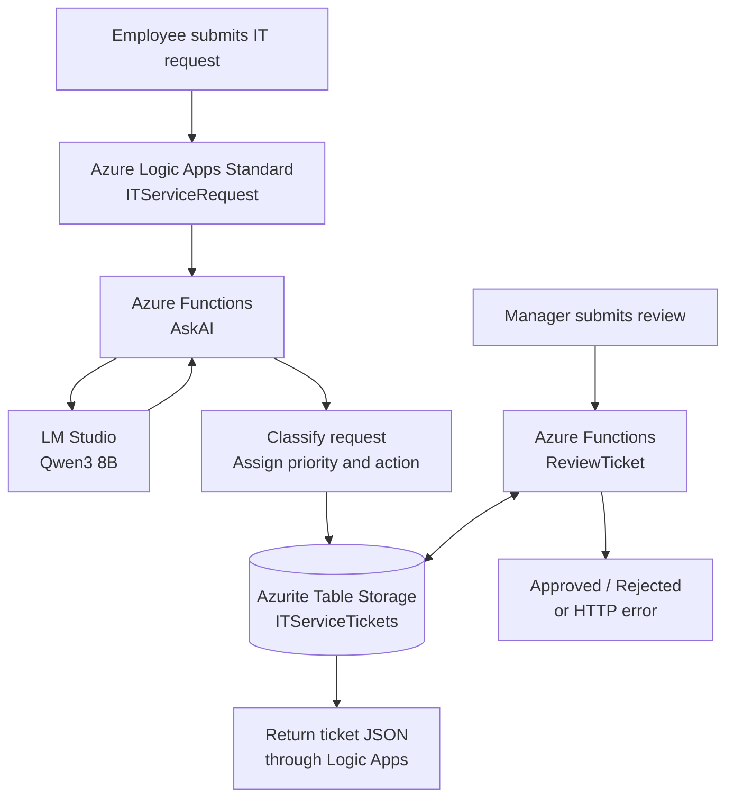

# AI IT Service Desk — System Architecture

## How it works

1. An employee submits an IT request to the Logic Apps HTTP trigger.
2. Logic Apps calls the `AskAI` Azure Function.
3. `AskAI` uses the locally hosted Qwen3 model through LM Studio to classify the request, with fallback logic if needed.
4. The function assigns a priority, generates a ticket ID, and saves the ticket in Azurite Table Storage.
5. Logic Apps returns the ticket details.
6. For tickets awaiting approval, a separate `ReviewTicket` endpoint processes manager approval or rejection and updates the stored ticket.

**Deployment:** Local Windows development environment. No Azure cloud subscription required.
